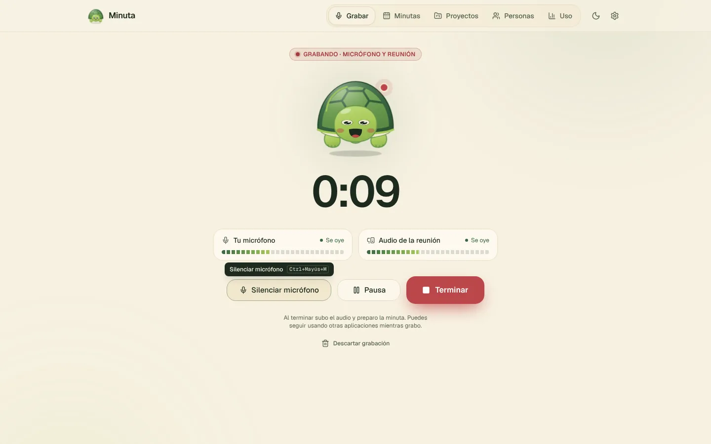
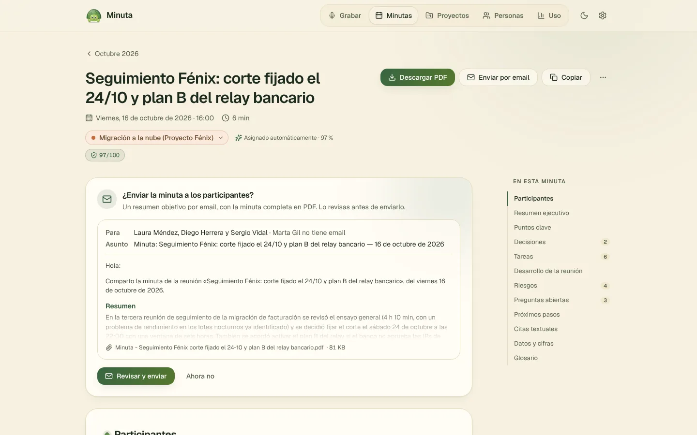

# Minuta

**Grabá tus reuniones y recibí la minuta lista para enviar.**

Graba el micrófono y el audio de la reunión (Teams, Meet, Zoom…), transcribe, y Claude redacta una minuta clara con decisiones, tareas y próximos pasos.

&nbsp;

---

<table>
<tr>
<td width="50%"></td>
<td width="50%"></td>
</tr>
<tr>
<td align="center">Grabás con un clic, la tortuga te acompaña</td>
<td align="center">La minuta queda lista para revisar, descargar en PDF o enviar</td>
</tr>
</table>

## 🚀 Instalación en 3 pasos

1. Entrá a **[la última versión](https://github.com/ifbotech/gestorDeMinutas-descargas/releases/latest)** y, en **Assets**, descargá `Minuta-Setup-<versión>.exe`.
2. Abrilo. Si Windows muestra *"Windows protegió su PC"*, tocá **Más información → Ejecutar de todas formas**.
   Aparece porque el instalador no tiene un certificado pago de firma; es normal.
3. Seguí el **asistente de primer uso**: tu nombre, las claves y una prueba del micrófono y del audio de la reunión.

> [!TIP]
> Después de instalarla una vez, **Minuta se actualiza sola**: descarga la versión nueva en segundo plano y la instala al cerrarla. Nunca se actualiza mientras grabás o procesás una reunión.

## 🔑 Claves que vas a necesitar

| Para qué | Servicio | Costo |
|---|---|---|
| Transcribir | [AssemblyAI](https://www.assemblyai.com) o [Speechmatics](https://www.speechmatics.com) *(recomendado)* | Tienen horas gratis por mes |
| Redactar la minuta | [Claude](https://console.anthropic.com) — Haiku 5.5 (predeterminado) o Sonnet 5.5 | Prepago, centavos por reunión |

Podés poner un **tope de gasto mensual de Claude** dentro de la app y ver el consumo en **Uso**.
Las claves se guardan cifradas en tu PC y solo se usan para hablar con cada servicio.

## ✨ Qué hace

- 🎙️ **Graba micrófono y reunión por separado**, eligiendo el dispositivo de cada uno, con filtros de ruido y eco.
- 📝 **Minuta completa**: resumen, puntos clave, decisiones, tareas, riesgos, preguntas abiertas y citas textuales.
- ✅ **Tareas con seguimiento** y recordatorios; en la reunión siguiente del proyecto se retoman las pendientes.
- 📅 **Calendario de Outlook**: toma el título y los participantes de la reunión en curso.
- 👥 **Personas y voces**: reconoce quién habla con huellas de voz guardadas *solo en tu PC*. El listado se puede importar desde CSV o Excel.
- 📚 **Glosario** que se alimenta solo con los nombres de proyectos, siglas y términos de tu equipo.
- 📁 **Proyectos**: cada minuta (`.md` y PDF) se guarda en la carpeta de su proyecto.
- ✉️ **Envío por email** con resumen y PDF adjunto, que revisás antes de mandar.
- 🤝 **Modo equipo**: compartí personas, proyectos y glosario a través de una carpeta de OneDrive/SharePoint.

## 💾 Tus datos

| Qué | Dónde |
|---|---|
| Configuración, claves cifradas, personas, voces | `%APPDATA%\Minuta` |
| Minutas y PDF | `Documentos\Minutas` (o la carpeta que elijas) |

- **Todo queda en tu PC.** El audio solo viaja al servicio de transcripción y el texto a Claude.
- **Desinstalar no borra nada**: si reinstalás, Minuta encuentra tus minutas, personas y claves tal como estaban.

## ❓ Ayuda

- Dentro de la app: botón **?** o tecla **F1** abre el manual.
- ¿Algo no anda o tenés una idea? Escribile a **Iñaki Barnetche**.

---

Este repositorio solo publica los instaladores y las actualizaciones de Minuta. Hecho por Iñaki Barnetche · 🐢

